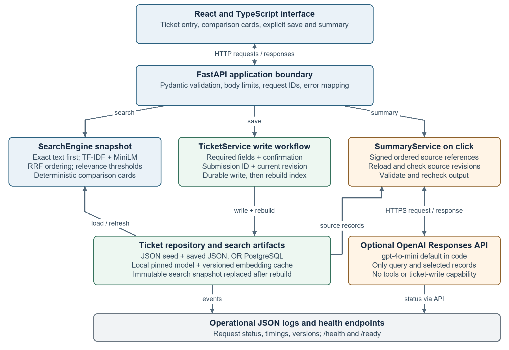
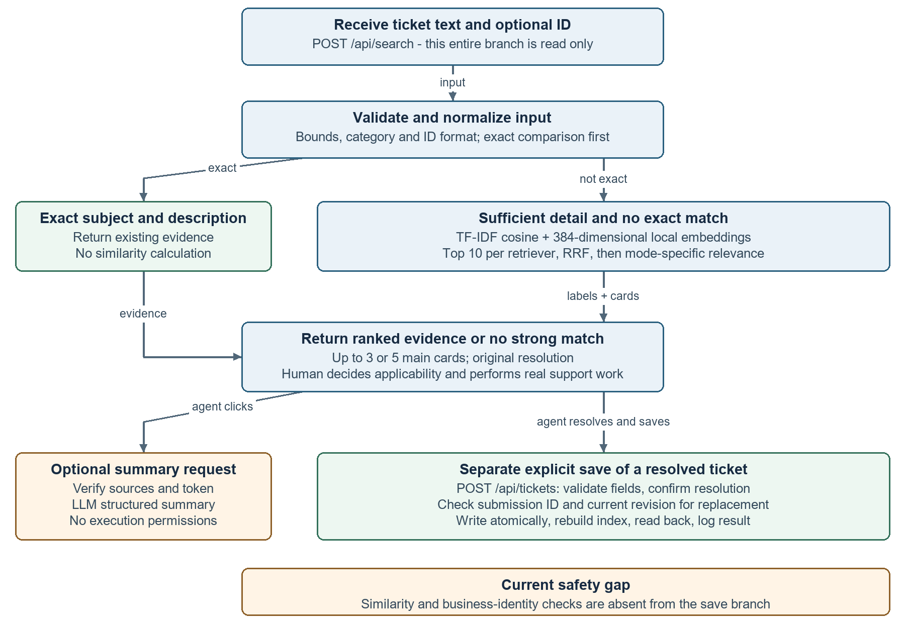
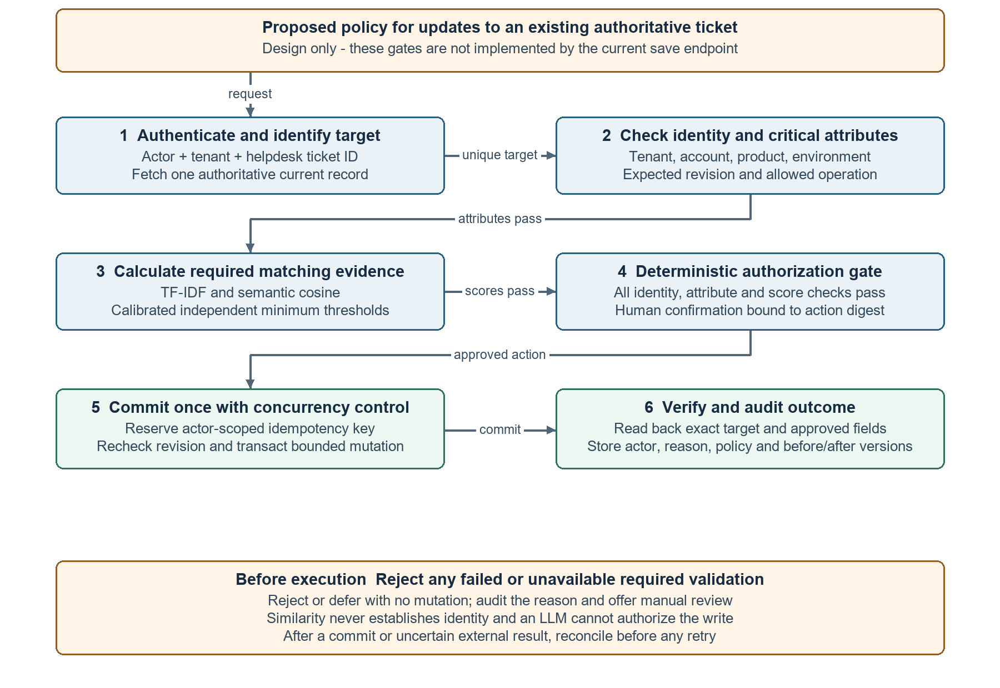

# Support Ticket Similarity Assistant

Solari Analytics | Technical submission | 17 November 2026

**Outcome.** The implemented assistant retrieves historical support evidence for a human agent, preserves recorded resolutions, and offers optional summaries and explicit resolution recording. The core local flow works. Production access control and the requested strict identity-and-similarity gate for updates remain incomplete.

## 1  Problem in our own words

Solari Analytics, a B2B dashboard provider of about 400 employees, receives around 150 support tickets daily. Agents can repeat investigations or give inconsistent answers because earlier resolutions are hard to discover. The assistant makes previous work visible before an agent decides how to resolve a new incident. No reduction in handling time or improvement in customer outcomes has been measured.

## 2  Assumptions and scope

| Assumption | Reason and consequence |
| --- | --- |
| Manual ticket entry; English text | The brief names no helpdesk or ingestion API. The implemented interface accepts subject and description, with optional ID, product, error detail and category. |
| Similarity is evidence for investigation | A matching symptom can have a different root cause. Retrieval labels do not authorize actions or prove incident identity. |
| 40-ticket seed is the evaluation baseline | The separate 1,000-ticket synthetic file is available but is not loaded by default. Thresholds were tuned against the 40-ticket seed. |
| Internal synthetic-data prototype | No authentication, role checks or tenant fields exist. Real customer data and public write access require additional controls. |
| Growth and latency require agreement | 150/day implies 54,750/year at 365 days, or 39,000 at 260 workdays, before growth. Proposed interactive target: p95 under 1 second; not a customer-approved SLA. |

## 3  Proposed approach and implemented architecture

A React and TypeScript client calls one FastAPI service. A validated immutable search snapshot holds the ticket records, TF-IDF matrix and local MiniLM embeddings. Exact subject-and-description comparison runs first; other searches use both retrievers, Reciprocal Rank Fusion and a separate relevance policy. Cards show stored resolutions, shared wording, differences and questions for the agent.

An explicit summary click invokes an optional structured-output LLM using signed result references and checked source revisions. A separate save endpoint records an agent's resolved ticket using JSON storage or PostgreSQL. The save commits before index rebuilding; a failed rebuild retains the previous search snapshot. Architecture and workflow diagrams appear on pages 5 and 6.

<!-- page break -->

# Design decisions and next steps

## 4  Main trade offs and decisions

| Decision | Why it fits this problem | Cost or limitation |
| --- | --- | --- |
| Local TF-IDF plus MiniLM | Keywords preserve codes; semantic search can retrieve differently worded symptoms. Local search makes no paid model request. | More dependencies and CPU than keywords alone. Negation and product differences can still mislead. |
| Rank fusion plus relevance policy | RRF orders candidates without comparing unlike raw scores; explicit thresholds control which records become main suggestions. | Conservative thresholds hide useful paraphrases. RRF itself is not a probability or a relevance test. |
| Deterministic cards; optional summaries | Agents can inspect the original evidence. Summary calls happen only on request and do not alter rankings or write tickets. | Structured output checks shape and source coverage, not truth. Human verification remains necessary. |
| One service with in-memory indexes | A small working deployment is appropriate to the provided seed and the brief's 3–4-hour target. No vector database is needed for this sample. | Full TF-IDF rebuilds and per-process snapshots limit growth and require freshness coordination. |
| JSON demo or PostgreSQL repository | JSON supports local startup; PostgreSQL implements transactions and row locking for durable concurrent writes. | JSON is safe only within one process. PostgreSQL integration was not rerun in the current evidence run. |

## Measured result and present boundary

Fresh checks: 164 backend tests and 71 frontend tests passed; 14 PostgreSQL tests were skipped. On the frozen 24-query synthetic final set, hybrid retrieval displayed the expected ticket for 5 of 12 answerable queries and ranked it in the first three for 10 of 12. No false close match appeared in the 11 designated no-match cases. These small counts do not establish production accuracy.

**Safety boundary.** Search performs no ticket writes. However, the explicit save endpoint accepts unrelated replacement content when supplied with the current target revision. A temporary-data probe reproduced that behavior with lexical cosine 0 and semantic cosine -0.043. Current revision checking prevents blind/stale writes; it does not satisfy the requested exact-identity and similarity policy.

## 5  With more time data or budget

First protect write, detail, refresh and paid-summary endpoints with authenticated roles and tenant filtering. Add the deterministic update gate described on page 11 if strict matching is required. Correct empty-index freshness and capacity enforcement, and invalidate cached ticket details on source revision changes.

Next review paraphrase and no-match behavior with support agents, label representative real tickets with appropriate privacy controls, and retune on a new held-out evaluation. Measure agent usefulness, handling time, false suggestions and response latency before adding a reranker, larger model or nearest-neighbor index. Validate deployment, backups and external integration only after the local safety conditions are met.

Evidence snapshot: commit 0acef1654e35, inspected working tree on 17 November 2026. Source files were not changed to complete this submission. Detailed requirements, algorithms, controls, tests and limitations follow.

<!-- page break -->

# Business requirements and traceability

The original brief is case-study-brief.md; no file named case study.md exists in the supplied project. It asks for ambiguity handling, sound design, a working similarity flow, clear communication and defensible trade-offs. No private scoring rubric or mandatory long-form section order was supplied. B indicates a brief requirement, A an explicit project assumption, and U a requirement added in the preparation request.

| ID and requirement | Implementation and evidence | Status |
| --- | --- | --- |
| B1 Find similar historical tickets | SearchEngine.search; keyword and semantic indexes; React search form and outcome cards. Supports exact and ranked retrieval. | Implemented; recall limited |
| B2 Show how past tickets were resolved | cards.build_card uses the canonical TicketRecord resolution; detail endpoint retrieves stored versions. Original records remain available beside summaries. | Implemented |
| B3 Working end-to-end prototype | FastAPI routes, React client, model preparation, Docker build definition and local run instructions. Backend and frontend checks executed. | Implemented locally; cloud unverified |
| B4 State assumptions and design choices | Two-page design overview above follows problem, assumptions, approach, trade-offs and future work. | Documented |
| B5 README and runnable source | Existing repository has dependencies, lockfiles and tests. A concise submission/README.md maps evaluator priorities and run steps. | Prepared; upload not performed |
| B6 Plan for growth | In-memory snapshots, embedding reuse, SQL repository and refresh polling are implemented. No representative high-volume load test exists. | Partial |
| B7 Optional AI enhancement | Pinned all-MiniLM-L6-v2 retrieval; explicit OpenAI summary integration. Provider tests use mocks, not a live paid endpoint. | Implemented; live summary unverified |
| A1 Prefer evidence over automatic resolution | No refund, account-reset, helpdesk update or command-execution integration exists. Agent actions are outside this application. | Implemented scope boundary |
| A2 Make uncertainty visible | Insufficient-input, no-strong-match, degraded retrieval and service errors are distinct. Main lists are never padded. | Implemented; related cards hidden on no-match screen |

## Users inputs outputs and success

Primary users are support agents; the customer sponsor is VP of Customer Success Jamie Chen. Operators manage indexes, storage and deployments. Inputs are ticket text and optional context; historical records provide ID, subject, description and resolution. Outputs are labelled evidence cards, original records, optional summaries, and separately saved resolution records. Success should be judged by useful prior evidence found, consistent advice and lower investigation effort; those business outcomes need an agent pilot.

<!-- page break -->

# Additional requirements and gaps

| ID and requested control | Code evidence and interpretation | Status |
| --- | --- | --- |
| U1 TF-IDF and semantic matching | retrieval/keyword.py and semantic.py implement both. Model metadata confirms 384 dimensions and 256-token inputs. | Implemented |
| U2 Combined matching score | fusion.py uses RRF ranks; relevance.py gates by raw cosine and coverage. No alpha/beta score is implemented. | Alternative implemented |
| U3 Authoritative identity before update | plan_save locates a ticket by ID and checks expected_revision. No external authority, tenant or account validation exists. | Partial |
| U4 Critical attributes and score thresholds before mutation | Save route does not invoke the search/relevance pipeline or compare immutable business attributes. Probe S03 demonstrates unrelated replacement. | Not implemented |
| U5 Reject ambiguous intended targets | Search preserves separate records with identical text; save operates on a supplied/generated ID. Intended-incident ambiguity is not assessed. | Partial |
| U6 Fail closed if embedding validation fails | Search degrades to keywords. Save commits then indexes; embedding failure can leave a saved, unindexed record (S05). This differs from the requested pre-write rule. | Not implemented for writes |
| U7 Idempotency and concurrency | submission_id, content comparison and revision checks; JSON locks; PostgreSQL transaction, row lock and primary keys. | Implemented; storage-specific scope |
| U8 Verify updates and audit rejections | Save reads back current record and reports indexing; logs ticket_saved/save_refused and request IDs. No immutable actor/tenant audit ledger or external side-effect verification. | Partial |
| U9 Security and privacy controls | Request limits, CSP, no-store headers, safe rendering, parameterized SQL and server-side secrets exist. Authentication, RBAC and tenant isolation do not. | Partial |
| U10 Cost and performance evidence | Local model; cached historical vectors; optional LLM calls. Measured retrieval timings and transparent scenario estimates provided. | Partial; no production telemetry |
| U11 Reliability and testing | 235 current application tests passed. Seven additional probes expose gaps outside that suite. Cloud, current PostgreSQL and live LLM checks remain outstanding. | Partial |

## Constraints and unresolved decisions

The brief expects roughly 3–4 focused hours and allows a deliberately small scope. TalentStudio limits the ZIP to under 50 MB and the design to 20 pages, reads roughly the first 100 README lines and contents of 15 files total. This PDF is 20 pages with three embedded raster diagrams. The short design is also supplied as Markdown. Resolve customer identity fields, permitted edit types, acceptable paraphrase risk, growth bursts, data retention, provider availability and hosting region before production commitments.

<!-- page break -->

# Architecture and trust boundaries

Figure 1. Implemented components. The external provider is optional; there is no helpdesk execution adapter.



**Read boundary.** Search accesses an immutable in-memory snapshot. Every card resolves its ticket by ID, which keeps resolutions attached to the right record even if corpus order changes. Records are loaded and validated at startup or refresh.

**Write boundary.** Only POST /api/tickets writes ticket content. TicketService invokes repository rules, commits a record and submission marker, then builds a complete replacement snapshot. JSON overlays preserve the original seed file; PostgreSQL stores all records in application-owned tables.

**AI boundary.** MiniLM runs locally on CPU. The optional LLM receives selected canonical sources over HTTPS and returns structured text. It has no execution tools and no call into TicketService. Signed summary references bind source order and versions; they provide integrity, not user authorization.

**Operations boundary.** JSON stdout events support diagnosis; /health checks process liveness and /ready checks the current search snapshot. Readiness is not a continuous database availability check. AWS provisioning scripts are present, but an actual cloud deployment is not verified here.

<!-- page break -->

# End to end workflow

Figure 2. Retrieval, optional summarization and explicit resolution recording are separate request paths.



| Stage | Actual behavior |
| --- | --- |
| Receive and validate | Reject malformed bodies, extra fields, invalid categories and oversized input. Preserve original text for display; use separate matching representations. |
| Calculate and decide | Exact text can bypass retrieval. Otherwise require enough meaningful terms, compute keyword and semantic evidence, merge ranks and assign relevance labels. |
| Respond and review | Build deterministic cards. With no main match the UI suppresses related cards and asks for human investigation; it does not execute a fix. |
| Record a resolved case | An agent explicitly submits resolution evidence and confirms resolution. The repository decides insert, unchanged repeat or revision-checked replacement. |
| Verify and log | Rebuild and atomically replace the search snapshot when usable. Read back the saved record, report indexed/failed state and emit operational events. |

<!-- page break -->

# Technology and implemented features

| Layer | Technology | Purpose | Reason for selection |
| --- | --- | --- | --- |
| Client | React 19.3.1; TypeScript 6.0.3; Vite 8.3.8; CSS | Ticket entry and evidence cards | Typed interactions and reusable views; static bundle served with the API. |
| API | Python 3.12; FastAPI 0.163.1; Pydantic 2.14.3; Uvicorn | Contracts and orchestration | Typed validation and a compact service around Python retrieval libraries. |
| Lexical | scikit-learn 1.9.1; NumPy 2.5.5 | TF-IDF and cosine | Inspectable sparse matching and a local fallback. |
| Semantic | Sentence Transformers 6.3.0; PyTorch 2.15.0 CPU; MiniLM | Local embeddings | Paraphrase retrieval without hosted embedding calls or a GPU. |
| Summary | httpx 0.28.1; OpenAI Responses; gpt-4o-mini default | Optional source summary | Structured text for explicit requests; model configurable, live use untested. |
| Storage | JSON or PostgreSQL; SQLAlchemy 2.1.9; psycopg 3.3.9; Alembic | Persist ticket records | Simple local demo or transactional shared storage. Search still uses memory. |
| Operations | Docker; ECR/ECS Express scripts; JSON logs; health routes | Package and observe | One image for UI/API/model; simple operational signals. Cloud unverified. |
| Tests | pytest 9.2.0; Vitest 5.1.0; Testing Library; ESLint | Verify behavior | Executable API, retrieval and interaction checks with controlled fixtures. |

## Feature inventory and code ownership

| Class and feature | Input to output and implementation | Failure boundary |
| --- | --- | --- |
| Core evidence search | TicketForm/useSearch -> /api/search -> engine.py -> cards.py. Returns labels, differences, raw evidence and original resolutions. | Reject invalid input; no-match and service error differ. |
| AI retrieval and summary | semantic.py encodes text; summaries.py checks a signed source set and returns citations and per-ticket summaries. | Keyword fallback or explicit summary error. |
| Automation and recording | ResolutionForm -> service.py -> repository. Saves an agent's investigation, resolution and verification; refresh rebuilds search state. | No automatic customer action; write and indexing can succeed separately. |
| Safety and validation | main.py and repository rules validate format, confirmation, submissions and revisions; summaries.py checks sources. | Implemented controls; strict mutation gate and access control missing. |
| Monitoring and administration | /api/meta, /health, /ready, refresh and JSON logs. session.ts holds recent searches and feedback. | Implemented operational views; no admin role or centrally learned feedback. |

<!-- page break -->

# Text preparation and TF IDF

## Preprocessing is purpose specific

text.exact_text changes CRLF/CR to LF and trims surrounding whitespace only. Exact comparison keeps case, punctuation, internal spacing, numbers and word order. It compares subject and description separately; a cosine of 1 is never used as proof of identical text or identity.

For retrieval, clean_text applies NFKC normalization and removes control characters. The tokenizer lowercases Latin letters and digits, preserves underscores in identifiers, removes an explicit short stop list, and maps negation words/contractions to 'not'. Pure numbers shorter than three digits are omitted from matching. Stemming is off; adjacent word bigrams are on. Highlight offsets preserve the displayed text. Preserving a negation token does not guarantee correct semantic reasoning about negation.

Ticket loading requires a valid ID, nonempty subject, description and resolution. Invalid records are counted by reason. Conflicting duplicate IDs retain the first accepted seed record and report the conflict. Identical wording under different IDs stays separate. Missing optional fields are unknown, not mismatches; a missing status is accepted with a warning by the generic loader.

## Implemented lexical calculation

The corpus document is subject plus description; resolution text is excluded from the retrieval index. Query product/error fields are appended when supplied. TfidfVectorizer fits vocabulary and IDF once per snapshot using sublinear term frequency, smoothed IDF and L2 normalization.

```text
tf(t,d) = 0 if count(t,d)=0; otherwise 1 + ln(count(t,d))
idf(t) = ln((1 + N) / (1 + df(t))) + 1
w(t,d) = tf(t,d) * idf(t)
v(d) = w(d) / ||w(d)||2
S_lex(q,d) = v(q) dot v(d)
```

N is the number of historical tickets and df(t) counts documents containing term t. Nonnegative cosine lies between 0 and 1; higher scores mean more shared weighted wording. An out-of-vocabulary term has no TF-IDF query dimension. A query with no known vocabulary has zero lexical signal and no keyword candidates.

## Coverage accounts for unseen words

```text
coverage(q,d) = sum[idf(t), t in Q intersect D]
                / sum[idf(t), t in Q]
```

Q and D are distinct unigram term sets. The denominator includes unseen query terms, using df=0 and therefore maximal smoothed IDF. This prevents one common known word from hiding a mostly unfamiliar problem. Coverage is separate from cosine and rank fusion.

Illustration: if N=40 and a term occurs in two documents, idf=ln(41/3)+1=3.615. Count 3 gives tf=2.099 and an unnormalized weight of about 7.586. All weights are then normalized together. These numbers illustrate the formula, not a measured production ticket.

<!-- page break -->

# Semantic matching fusion and thresholds

The actual model is sentence-transformers/all-MiniLM-L6-v2 at revision 1110a243fdf4706b3f48f1d95db1a4f5529b4d41. The local manifest and executed model checks confirm 384 float32 dimensions and a 256-token input limit. Historical input is subject plus description; query input can additionally contain product and error details. Model weights are loaded once from local disk with network use disabled during inference.

```text
e(x) = encoder(x) / ||encoder(x)||2
S_sem(q,d) = e(q) dot e(d)
For query windows q1..qm: S_sem(q,d) = max_j e(qj) dot e(d)
```

Semantic cosine can range from -1 to 1. Higher similarity can capture paraphrases with few shared words, but it is not a probability that a resolution applies. Query text is split into at most 24 token-budgeted windows; the best window score is used. Historical records are encoded as single texts and can be truncated beyond the model limit. A single oversized query token also needs additional handling; do not claim full long-input coverage in every case.

## Rank fusion is the implemented combination

```text
RRF(d) = I_kw(d)/(60 + rank_kw(d))
       + I_sem(d)/(60 + rank_sem(d))
```

Each retriever contributes its top 10; missing-list contributions are zero and ranks start at one. Ties use best individual rank then ticket ID. Example ranks 1 and 3 give 1/61 + 1/63 = 0.03227. RRF controls ordering only. The optional alternative alpha*S_lex + beta*S_sem, with nonnegative weights summing to one, is not implemented or calibrated. Adopting it would require calibration and a new held-out comparison; no recommended weight is invented.

| Mode | Close match condition | Related condition if not close |
| --- | --- | --- |
| Hybrid | Semantic >= 0.90 OR (semantic >= 0.75 AND coverage >= 0.30) | Semantic >= 0.33 OR keyword >= 0.30 |
| Keyword only | Keyword >= 0.45 AND coverage >= 0.30 | Keyword >= 0.20 |
| Semantic only | Semantic >= 0.78 | Semantic >= 0.33 |

Candidates failing both conditions are dropped. The main limit is 3 or 5 after filtering; related results are capped at 3. Threshold version 2026-11-17.1 was tuned on 28 synthetic queries against 40 tickets. Margins were small and paraphrase scores overlapped unrelated cases. These retrieval thresholds are not execution thresholds, and no simultaneous minimum lexical-and-semantic gate exists in the save route.

<!-- page break -->

# Current write controls and safety decision table

POST /api/tickets validates required investigation, resolution and verification text, labels, ID format and confirmation. A submission ID identifies a request. An absent ticket ID generates a new ID; a supplied unknown ID inserts once. An identical repeat returns unchanged. Different content for an existing ID requires the current 16-hex-character revision. This protects against blind and stale overwrites, but not against an unauthorized or semantically unrelated replacement.

| Condition | Current implementation | Required strict policy |
| --- | --- | --- |
| Exact authoritative identity and all checks pass | No authoritative tenant/account check. Current revision permits replacement. | Approve only after authorization, attributes and both required score thresholds pass. |
| Similar text, different ticket ID | Separate record; a new ID may be inserted. Search never merges incidents. | Reject an attempted update to the wrong intended ID; no mutation. |
| Low lexical or semantic similarity | No score check on save. S03 updated unrelated text with current revision. | Reject; no update even if a weighted aggregate would be high. |
| Missing mandatory attributes | Missing form fields rejected with 422. Tenant/account identity fields do not exist. | Reject missing business identity or authorization attributes. |
| Ambiguous candidates | Search may return multiple exact-text records. No ambiguity gate in save. | Manual review; no automatic target selection. |
| Model/validation service unavailable | Read-only search may fall back. Save can commit and then report failed indexing (S05). | Reject/defer a gated mutation; do not bypass a mandatory validation. |
| Duplicate submission | Same request returns unchanged; changed content with same key returns 409. | Maintain idempotency scoped to actor, tenant and action. |
| Stale revision or blind overwrite | 409 ticket_conflict before mutation. | Retain the rejection and recheck under lock at commit. |

## Observed counterexample and conclusion

S03 retrieved the revision of synthetic T-1001, then submitted unrelated lunar-valve content. Lexical cosine was 0.0000, semantic cosine -0.0430 and coverage 0.0000. The API returned 200 updated and read-back confirmed replacement in the temporary store. This falsifies the statement 'a non-matching ticket can never trigger an update' for the explicit save endpoint. The original project dataset remained unchanged.

Search itself remained read only (S01), a blind overwrite was rejected (S02), and replay was idempotent (S04). Those are verified properties with narrower scope. No refund/reset/account-change integration exists, and the LLM cannot directly execute a write. The remaining policy is a proposed implementation on the next page.

<!-- page break -->

# Proposed exact identity execution gate

Figure 3. Proposed deterministic mutation policy. This design must not be described as implemented.



Receive the incoming record and requested operation; extract tenant, external system, unique ticket ID and mandatory business context; retrieve exactly one authoritative target. Require immutable identity fields to agree and restrict which fields may change. An existing-ID edit and creation of a new incident need distinct policies.

Calculate lexical and semantic similarity against the approved target or immutable target snapshot, then require independently calibrated minima in addition to identity and attributes. Treat low scores as a reason for review, never high scores as proof of identity. A legitimate large correction may fail the similarity policy and must use a separately authorized manual workflow.

Bind explicit confirmation to the target, revision and proposed field changes. Within a transaction, reserve an actor/tenant-scoped idempotency key, recheck revision and authorization, and execute only the allowlisted changes. Read back the intended target, verify affected fields and commit an audit record. Rejections need actor, reason code and correlation ID without sensitive text.

For a future external helpdesk operation, use an outbox, provider idempotency where available and reconciliation after ambiguous timeouts. Never retry an uncertain side effect blindly. Select numeric execution thresholds only after representative positive and negative tests; until then, keep such automated mutations disabled.

<!-- page break -->

# Exception handling and reliability

| Exception or risk | Detection and handling | Response or remaining gap |
| --- | --- | --- |
| Malformed JSON, wrong type, extra field | Pydantic plus RequestValidationError mapping in main.py. | 422 with fixed field errors; rejected input is not echoed. |
| Missing required text or confirmation | _validate_save checks fields and confirm_resolved. Empty search is checked separately. | 422; no save. Vague but nonempty search returns insufficient_input. |
| Oversized body or text | ASGI middleware counts streamed bytes; schema and route enforce field limits. | 413 body or 422 field error before expensive work. |
| Unknown ID or category | ID syntax check, repository lookup and engine category validation. | 404 detail or 422 category; unknown search ID is reported without insertion. |
| Duplicate ID or ambiguous text | Loader reports conflicting IDs; exact search preserves different IDs with identical text. | First seed ID wins; duplicate text is not proof of identity. No save ambiguity gate. |
| Duplicate or stale write | Submission replay/content checks and current-revision comparison in plan_save. | Unchanged repeat or 409; PostgreSQL retries an insert race up to four attempts. |
| Store failure at startup | Repository/loader exception becomes explicit unavailable state; PostgreSQL has no JSON fallback. | 503 when no usable snapshot; /health still reports alive. |
| Store failure after startup | Save/detail paths read the repository; search holds a prior in-memory snapshot. | Writes can fail while search and /ready continue. Freshness can diverge from availability. |
| Model load or query failure | SemanticError selects keyword fallback. Three consecutive semantic query failures disable that path. | Degraded mode is reported; no timed recovery probe. Restart/rebuild recovery is limited. |
| Low similarity | Mode-specific relevance thresholds. | Drop or related context; no mutation from search. Save does not use these thresholds. |
| Indexing or cache-write failure | Build off to the side; swap only a usable candidate. Vector-cache errors are nonfatal. | Saved record can remain pending/failed while old snapshot serves requests. |
| All eligible records disappear | Current rebuild rejects an empty snapshot as unusable. | S06: deleted record remained searchable; /ready 200, detail 404. Correction required. |
| LLM timeout, quota, refusal, bad output | httpx timeout/status mapping; strict shape, ordered IDs and citation validation. | 504/429/502 as applicable. Results stay available; no automatic provider retry. |
| Expired, edited or substituted sources | HMAC token, identity/order binding and revision checks before and after provider call. | 409 refresh-required. A source can change again after the final check; summary is a versioned snapshot. |
| Concurrent load and network loss | Four search slots, five-second acquisition timeout; two independent summary slots. UI aborts search after 15s and save after 20s. | Busy 503. Client abort may not stop backend work; save replay reuses submission ID. |
| Unauthorized access or excessive usage | No application authentication, per-user rate limit or usage budget. | Not prevented. Concurrent-slot limits are not authorization or spending limits. |

<!-- page break -->

# Security and data integrity

## Implemented controls and their limits

| Area | Existing mechanism | Scope and limitation |
| --- | --- | --- |
| Input and output safety | Typed schemas; extra fields forbidden; label/ID patterns; size caps; structured errors; React text rendering. | Validation proves format, not ownership or that resolution evidence is truthful. |
| Browser protections | CSP restricting scripts/connects to self, frame denial, nosniff, no-referrer and no-store API headers. | No authentication or per-tenant filtering. Same-origin design is not an access-control system. |
| Secrets and network | API key, database URL and optional signing key remain backend settings using SecretStr. LLM request uses HTTPS and store=false. | No verified secret-manager deployment, rotation, DB TLS enforcement or ticket PII redaction. store=false is not a universal retention guarantee. |
| Summary integrity | HMAC SHA-256 token with 900-second default TTL, ordered source IDs, revisions and optional proxy identity binding. | Token is readable, not encrypted. Default anonymous identity is None. No replay-based spending control or fact verification. |
| SQL and concurrent writes | SQLAlchemy bound values, primary-key IDs, SELECT FOR UPDATE, atomic ticket/submission transaction. | Current DB integration checks skipped. No role/tenant policy; revision knowledge is not permission. |
| JSON writes | Locked in-process save, copied payload, temporary file, flush/fsync and atomic os.replace. | Original seed stays untouched. No cross-process lock; local disk/volume durability is an operator responsibility. |
| Audit and privacy | Request IDs, timings, status codes, versions, returned ticket IDs and save/refusal events in JSON stdout. | No append-only ledger, verified actor for anonymous saves, before/after audit history or retention policy. Operational IDs/revisions are still metadata. |

## Identity isolation and mutation integrity

IDENTITY_HEADER only reads an operator-configured proxy header and overrides the form's resolved_by value. It does not require an authenticated request, authorize a role or prevent a caller reaching the backend directly. A trusted proxy must strip client-supplied identity headers, enforce authentication and restrict backend ingress before that integration can be trusted.

In JSON mode, locks and atomic replacement prevent a partial file write within one process. In PostgreSQL, the ticket and idempotency marker share a transaction; a trigger increments row version and queues reindexing on content changes. Indexing is outside the save transaction, so persistence and searchability are deliberately separate outcomes. There is no external-operation transaction or reconciliation layer.

## Controls required before real customer use

Add authenticated read/write/admin roles, tenant-aware filtering before retrieval and on direct record access, data minimization/redaction, HTTPS ingress and database transport settings, restricted secrets delivery, per-user and global usage budgets, and protected durable audit storage. Preserve server-side revision checks. Keep optional public writes and paid summaries disabled until those controls are verified.

<!-- page break -->

# Cost efficiency in the implementation

| Technique | Evidence and operational effect | Status |
| --- | --- | --- |
| Avoid automatic LLM calls | Search, page load and result-count changes do not invoke the summary provider; one explicit summary request makes at most one provider call. | Implemented |
| Cheap checks first | Input limits, exact-text lookup and meaningful-term checks run before embedding inference. | Implemented |
| TF-IDF as initial expensive-work filter | Keyword evidence is computed before semantics, but a low lexical score does not skip semantic retrieval. Doing so could lose paraphrases. | Not implemented; evaluate before adding |
| Local query embeddings | CPU MiniLM encodes non-exact queries; no external embedding API charge. There is no repeated-query embedding cache. | Implemented; cache is proposed |
| Cache historical embeddings | Reuse vectors by text hash, model ID/revision, dimension and template. Reuse loaded model on rebuild. | Implemented |
| Avoid duplicate work | Unchanged saves can reuse the live revision; identical saved requests are idempotent. UI deduplicates identical in-flight searches. | Implemented, scoped |
| Deduplicate new embedding batches | Missing rows are batched, but identical new text within the same cold batch is not explicitly deduplicated. | Partial |
| Batch where appropriate | Local encode uses batch_size=16 for missing history and query windows. Interactive LLM path does not use Batch API. | Local batching only |
| Bound summary size | Only up to 3 or 5 main records; no related records; 30,000-character source budget and 3,000 output-token cap. | Implemented; character cap is not token metering |
| Small configurable summary model | SUMMARY_MODEL defaults to gpt-4o-mini. No model router, quality/cost comparison or live provider measurement. | Configured; availability must be checked |
| Bound retries | No automatic LLM retry; PostgreSQL insert/conflict retry loop is bounded to four attempts. | Implemented; no exponential backoff |
| Efficient storage access | Search uses memory. PostgreSQL uses ID keyset loading in batches of 500, PK lookup, status and unindexed indexes, and connection pooling. | Implemented; no query benchmark |
| Rate, deduplication and usage budgets | Concurrency caps exist; no per-user rate limit, token ledger, daily spend ceiling or summary cache. | Partial; material public-cost gap |

These mechanisms reduce specific sources of avoidable work; they do not demonstrate measured savings. The following calculation compares explicit usage scenarios, with a separate infrastructure line. It does not infer token usage from character limits or equate local inference with zero compute cost.

<!-- page break -->

# Transparent monthly cost scenario

**Illustrative assumptions, not measured billing:** 150 tickets/day, 30 days/month, one search per ticket, 2,000 input tokens and 400 output tokens per successful summary. The baseline summarizes every ticket once; the demand-driven scenario summarizes 20% once. No retries, provider cached-input discount, taxes or currency conversion are assumed. Real prompt/schema overhead must be included in measured token usage.

```text
T = 150 * 30 = 4,500 tickets/month
C_call = (2,000 * 0.15 + 400 * 0.60) / 1,000,000
       = USD 0.00054 per illustrative summary
C_LLM = T * summary_fraction * calls_per_summary * C_call
```

| Cost item | Baseline every ticket | Demand driven scenario |
| --- | --- | --- |
| Summary calls per month | 4,500 | 900 (assumed 20% usage) |
| LLM input / output tokens | 9.0M / 1.8M | 1.8M / 0.36M |
| Monthly summary API cost | USD 2.430 | USD 0.486 |
| Hosted embedding calls | 0; local MiniLM | 0; local MiniLM |
| One always-on compute task | USD 35.547 illustrative | USD 35.547 illustrative |
| Compute plus summary subtotal | USD 37.977 | USD 36.033 |
| Subtotal per input ticket | USD 0.00844 | USD 0.00801 |

OpenAI's model page lists GPT-4o mini at USD 0.15 per million input tokens and USD 0.60 per million output tokens, with a separate cached-input rate. It also marks the model deprecated as checked on 17 November 2026. These rates are reference inputs, not proof the configured alias is usable for this account. Validate availability and reprice the selected model before enabling summaries. Source: https://developers.openai.com/api/docs/models/gpt-4o-mini

## Infrastructure calculation and exclusions

```text
C_compute = 720 hours * 3,600 * (1 * 0.000011244
                                  + 2 * 0.000001235)
          = USD 35.546688 per 30-day month
```

This uses AWS's published Linux/x86 US East (N. Virginia) Fargate example rates for 1 vCPU and 2 GB, matching the example task size. It is a reference scenario, not a quote for ap-south-1 listed in the local deployment-status report. Obtain region-specific rates before budgeting that deployment. Source: https://aws.amazon.com/fargate/pricing/

Add database compute/storage/backups, load balancing, public IP/network charges, ECR storage, logs, transfer, secrets and build compute as separate terms. JSON has no database service fee but still needs durable storage. Managed PostgreSQL price is unknown without region, class, size, HA and retention choices. The deployment permits up to two tasks, so autoscaling can increase compute cost.

```text
C_total = C_compute + C_LLM + C_database + C_storage
        + C_network + C_logs + C_build + other services
Cost per successful ticket = C_total / (4,500 * success_rate)
```

If success_rate were 95%, the demand-driven subtotal alone would be USD 36.033/4,275 = USD 0.00843 per successful response, before excluded costs. A technically successful response is not a solved customer incident. The hypothetical summary-only difference is USD 1.944/month (80%); no actual savings are claimed.

<!-- page break -->

# Retrieval results performance and scale

A fresh run used the unchanged final_queries.json: 24 queries, consisting of 12 answerable, 11 designated no-match and one vague input, against the 40-ticket seed. Thresholds were not retuned. Labels are supplied synthetic judgments; their agreement is not an independent human validation or production ground truth. This is a rerun of a previously used evaluation set, not a newly unseen holdout.

| Measured final-set result | Hybrid | Keyword | Semantic |
| --- | --- | --- | --- |
| Expected ticket among main matches | 5/12 | 5/12 | 6/12 |
| Expected ticket ranked top 3 before relevance gate | 10/12 | 7/12 | 12/12 |
| Any false main match on designated no-match cases | 0/11 | 3/11 | 1/11 |
| Paraphrase shown as a main match | 0/6 | 0/6 | 0/6 |
| Engine latency median, ms | 64.19 | 2.62 | 57.47 |
| Engine latency p95, ms | 161.37 | 3.34 | 114.85 |
| Engine latency maximum, ms | 211.65 | 4.22 | 155.79 |

The starter scorer ranked an expected ticket in its first three for 8/12 answerable queries and always returned three records. Above timings are in-process warmed search totals on this Windows host, 24 samples per mode, with one Torch thread and other verification work potentially concurrent. They exclude HTTP/browser latency and provider generation; they are not a throughput or isolated hardware benchmark.

## Customer usefulness and measurement limits

For hybrid retrieval, all six paraphrase cases fail the main relevance threshold. OutcomeArea hides related cards when status is no_strong_match, even if the backend retrieved the right ticket as related context. A ranking score therefore overstates what the agent can see. Preserve this distinction in the demo; do not present 10/12 ranking recall as 10/12 useful displayed answers.

| Unmeasured dimension | Concrete benchmarking plan |
| --- | --- |
| HTTP latency and throughput | Use a disposable instance, fixed hardware and warmed/cold runs; issue 1, 4, 8 and 16 concurrent clients, record p50/p95/p99, errors and queue waits over at least 10 minutes. |
| Corpus and refresh scale | Compare 40, 1,000 and realistically labelled 10k/50k records. Measure TF-IDF fit, model encoding, full rebuild, memory and deletion freshness; retune only on training/tuning data. |
| Database and LLM latency | Measure PK lookups, paginated corpus loads, transaction conflicts and outage recovery. Separately measure live summary TTFT/total latency, token usage and human faithfulness ratings. |

Semantic scanning costs roughly O(N*d*w) for N records, dimension d=384 and query windows w; sorting also grows with N. Raw float32 vectors need about 58.6 KiB at 40 tickets, 1.46 MiB at 1,000, and 73.2 MiB at 50,000, excluding the model, text and other indexes. Use shared PostgreSQL, refresh coordination and common summary signing keys for replicas. Consider an ANN index only when measured scan latency or memory justifies it; that component is not present today.

<!-- page break -->

# Executed tests and validation results

Executed on 17 November 2026: backend 164 passed, 14 PostgreSQL tests skipped; frontend 71 passed across 7 files. Type checking, ESLint and Vite production build passed. Deployment configuration: 19 cases, 0 failures. Expanded dataset: 16 structural checks passed, no configured content flags. The latter does not certify fictional resolutions. Existing tests generally use fake embeddings/mocked APIs, with four real local-model tests; no live paid LLM request was made.

| ID | Scenario and input | Expected result | Actual and status |
| --- | --- | --- | --- |
| T01 | Malformed/oversized API input | 422/413 without sensitive echo | Existing API tests passed |
| T02 | Exact text; cosine=1 with changed order | Exact-text path only for actual text equality | Existing exact/duplicate tests passed |
| T03 | Stored resolution and reordered corpus | Correct record retained by ID | Existing engine/card tests passed |
| T04 | Missing/failing local model | Explicit degraded keyword fallback | Existing engine/model tests passed |
| T05 | Parallel duplicate save; stale revision | One record; stale mutation rejected | Existing JSON workflow tests passed |
| T06 | Tampered/expired summary; bad provider sources | Reject incorrect sources; keep search usable | Existing mocked summary tests passed |
| T07 | Frontend edits, stale responses, summary failures | Newest request wins; correct error states | 71 mocked frontend tests passed |
| S01 | Existing ID with unrelated search text | No mutation | 200 search; no saved store; seed unchanged. PASS |
| S02 | Unrelated overwrite without revision | 409, unchanged target | 409 ticket_conflict. PASS |
| S03 | Same ID/current revision; unrelated text; no login | Reject under requested strict policy | 200 updated; lexical 0, semantic -0.043. FAIL policy |
| S04 | Replay identical S03 submission | No duplicate update | 200 unchanged; repeat true. PASS |
| S05 | Encoding failure during save/index rebuild | No mutation under requested pre-write policy | 201 saved; indexing failed. FAIL policy |
| S06 | Delete all source tickets then refresh | Deleted records absent from search | Old ticket still returned; detail 404. FAIL freshness |
| S07 | Two saves with capacity configured to one | Reject second new ticket | Both returned 201. FAIL configured limit |
| T08 | Current PostgreSQL integration suite | Transactional/concurrent invariants verified | 14 SKIPPED; disposable DB not configured |
| T09 | Live provider, cloud, sustained load | Functional/quality/SLO verification | NOT RUN; no pass claim |

Safety probes used temporary copies of synthetic data and left the original seed hash unchanged. FAIL policy means the observed behavior violates the additional requested safety rule; it is not a fabricated failure in the existing pytest suite. The existing tests intentionally permit revision-checked replacement. Raw JUnit reports, command logs and the reproducible probe script are in reports/submission-preparation-2026-11-17/.

<!-- page break -->

# Prioritized improvements and acceptance checks

| Priority and change | Impact and effort | Acceptance evidence needed |
| --- | --- | --- |
| Immediate: define edit authority and add access control | High impact; medium/high effort. Protect read, save, refresh and paid-summary routes; define tenant/account scope. | Anonymous and cross-tenant operations denied; direct backend access cannot spoof identity; per-role operation tests. |
| Immediate: implement the agreed mutation gate | High impact; medium/high effort. Bind identity, attributes, revision, approved fields, score policy and idempotency. | Every mismatch, ambiguous target and mandatory validation failure leaves target content unchanged. LLM output cannot supply authorization. |
| Immediate: empty-corpus freshness | High integrity impact; low/medium effort. Distinguish successful empty reload from a failed read. | Deleting/reopening all eligible tickets removes old evidence and gives an accurate readiness/no-history state. |
| Immediate: enforce capacity atomically | Medium impact; low/medium effort. max_saved_tickets is declared but unused. | At limit, new inserts rejected; legitimate updates and idempotent replays remain available under concurrency. |
| Immediate: current ticket-detail cache and timeout | Medium impact; medium effort. Cache is keyed by ID and can survive external updates; ordinary fetchTicket has no timeout. | After a fresh search/revision, expanded detail is current. A hung request times out, releases its claim and can retry. |
| Next: improve useful paraphrase visibility | High business impact; medium effort. Review relevance labels and a clearly labelled related-evidence path with agents. | New held-out set separates rank recall, visible recall and false suggestions; no forced padding or unsupported precision claim. |
| Next: provider and budget validation | Medium impact; medium effort. Verify a supported model, token metering, access/rate budgets and summary faithfulness. | Live structured-output smoke test, usage accounting, quota exhaustion and human source-faithfulness review. |
| Next: reliability and operational validation | High impact; medium effort. DB outage tests, bounded detail requests, model recovery, index freshness metrics and monitoring. | Fresh isolated PostgreSQL run, restore test, deletion checks, alert exercise and measured deployment readiness. |
| Longer term: retrieval and data growth | Conditional impact; medium/high effort. New labels, approved/workaround/outdated flags, incremental refresh and eventual ANN/reranker if justified. | Representative volume benchmarks and customer-reviewed relevance gains without lost authorization filtering. |

## Missing information to resolve with the customer

Confirm the external ticket system and authoritative ID fields; account/tenant boundaries; required immutable attributes; allowed edits and manual exceptions; languages and ticket lengths; peak growth; acceptable missed/false suggestions; response-time target; whether summaries may send ticket text externally; data retention; deployment region; and who can approve a resolution. No assumptions about these have been converted into implementation claims.

<!-- page break -->

# Reproduction and evaluator navigation

## Run the existing application

```text
cd backend
uv sync
uv run python -m app.prepare fetch-model
uv run python -m app.prepare build-index
$env:PORT = '8000'; uv run python -m app

# Second PowerShell terminal
cd frontend
npm ci
npm run dev
```

Open http://localhost:5173. The first model download needs network access; runtime retrieval uses local files. Without the model, keyword mode can still run. Docker alternative: docker build -t ticket-similarity-assistant . and docker run --rm -p 8080:8080 ticket-similarity-assistant. For JSON persistence mount a state volume; use one process. PostgreSQL setup and migrations are documented in POSTGRES.md. No cloud provisioning or submission upload was performed in this task.

## Files to prioritize within the evaluator read budget

| File or group | Evidence to inspect |
| --- | --- |
| This PDF; submission/README.md; submission/SOLUTION_DESIGN.md | Design, run guide and the brief's concise design companion. Use the staging README at ZIP root when assembling the upload. |
| backend/app/engine.py | Exact-text path, similarity orchestration, snapshot modes and label application. |
| backend/app/retrieval/keyword.py; semantic.py | TF-IDF/coverage, pinned local embeddings, windows and artifact reuse. |
| backend/app/retrieval/fusion.py; relevance.py | Rank fusion formula and raw-evidence relevance conditions. |
| backend/app/main.py | Schemas/routes, input checks, write boundary, error mapping and request logs. |
| backend/app/repository/base.py; json_repo.py; postgres.py | Save policy, content/revision/idempotency checks, atomic file/SQL storage. |
| backend/app/service.py; summaries.py | Save/index lifecycle and checked optional provider boundary. |
| backend/tests/test_resolution_workflow.py | Executed write invariants and intended revision-checked replacement behavior. |

The table prioritizes 12 source/test files plus three design/README files, matching the guide's 15-file content budget. Retain all necessary source, configuration and lockfiles in the runnable submission even though the evaluator may read only a subset. This selection is guidance; extraction order is controlled by TalentStudio.

## Packaging and evidence discipline

ZIP must be under 50 MB. Exclude .venv, node_modules, local model weights, caches, generated builds, state, secrets, QA images and bulky data-generation files. Keep the small seed/example JSON needed to run; the model is obtained by the documented preparation step. Diagrams are embedded as raster pictures in this text-based PDF; supporting PNG/Mermaid files are for editing, not separate TalentStudio image attachments. No organizer template beyond the supplied brief and quick guide was available.

<!-- page break -->

# Final technical audit and references

| Review perspective | Evidence-based assessment |
| --- | --- |
| FDE business judgment | The design addresses repeated investigation and inconsistent advice with inspectable historical evidence. Assumptions and customer decisions are explicit. Business benefit has not yet been measured. |
| Solution architecture | Read-only retrieval, optional summarization and explicit persistence are understandable and separated. The modular monolith fits the seed scale; shared persistence alone does not make index replicas instantly consistent. |
| Backend engineering | Validation, idempotency, revision checks and atomic persistence are present. Unauthenticated writes, empty-snapshot refresh and the unused capacity setting remain gaps. Save success and indexing success are separate. |
| AI and retrieval engineering | TF-IDF, coverage, local embeddings, RRF and thresholds match the code. Scores do not prove identity. Visible paraphrase recall is poor and no live summary-faithfulness result is claimed. |
| Automated submission review | The 20-page PDF is text based with three embedded raster diagrams, labelled paths, formulas, status tables and evidence references. The short design preserves the brief's required five topics. No private score or hiring outcome is predicted. |

## Claim audit

**Verified:** search-only requests do not save tickets; exact-text equality is separate from cosine; local semantic retrieval exists; current revision checks reject blind/stale replacements; repeated submissions are idempotent; 235 current application tests passed; the frozen retrieval results were rerun.

**Not claimed:** strict identity/attribute/similarity gating before writes, no possible wrong-target update, authentication, tenant isolation, immutable compliance audit, measured cost savings, production throughput, achieved response-time SLA, a live cloud deployment or live LLM success. Proposed mechanisms are visibly labelled and do not alter the application's current behavior.

## Evidence references

| Reference | Location and scope |
| --- | --- |
| Requirements | case-study-brief.md; supplied Student Quick Guide dated 3 November 2026; final preparation request. The preparation request adds stricter execution requirements than the original similarity brief. |
| Executed tests | reports/submission-preparation-2026-11-17/backend-tests.xml and frontend-tests.xml; accompanying logs; frontend-typecheck.log, frontend-lint.log and frontend-build.log. |
| Retrieval and probes | Same folder: retrieval-final.json, safety-probes.json and verify_submission.py. Configuration: backend/config/relevance.json. Inputs: backend/evaluation/data/final_queries.json. |
| Other checks | Same folder: deployment-config.log and dataset-validation.json. Older review reports were used only as leads; present conclusions cite current code or fresh observations. |
| Published cost inputs | OpenAI GPT-4o mini model page and AWS Fargate pricing page, accessed 17 November 2026. URLs appear alongside the estimates on page 15. |

Source snapshot: Git commit 0acef1654e35a6184e284185e6ef99f5f07eeeb4 plus the inspected working tree. Pre-existing SOLUTION_DESIGN.md edits and earlier reports were preserved. Application code, seed data, model parameters and thresholds were not changed. The final document records current behavior and the work needed to meet the additional safety policy.
